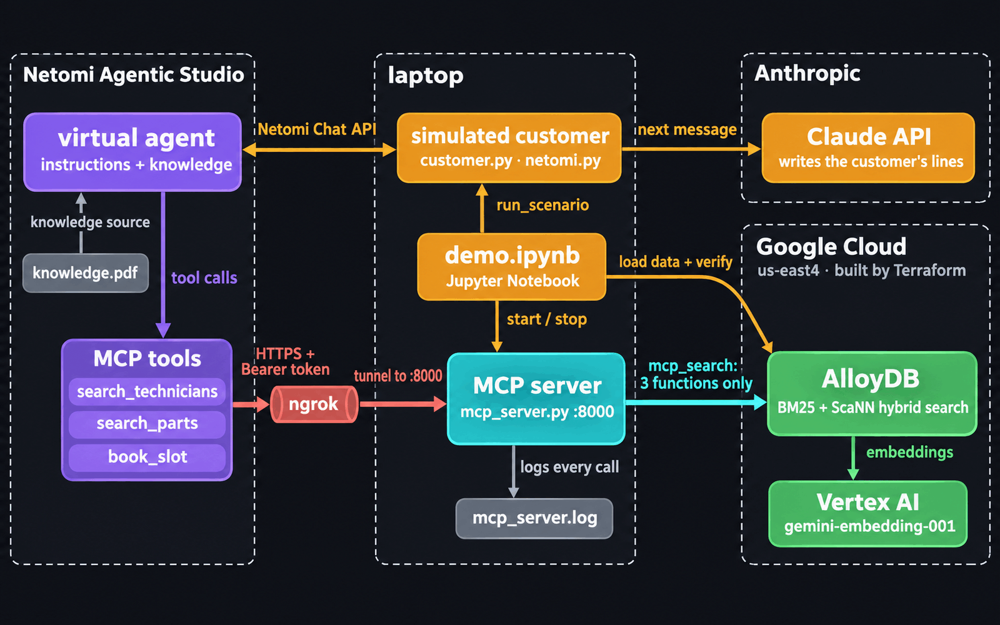

# Rules in the Tools: a Netomi Agent with Live Search on AlloyDB

## Contents
1. [Summary](#summary)
2. [Presentation](#presentation)
3. [Architecture](#architecture)
4. [Features](#features)
5. [Prerequisites](#prerequisites)
6. [Installation](#installation)
7. [Usage](#usage)
8. [Notes](#notes)

## Summary 
A Netomi virtual agent handles appliance-repair support for "Summit Home Services", a fictional repair network. It explains error codes from a knowledge source, finds the right technician or replacement part with hybrid search in AlloyDB (BM25 keyword search plus ScaNN vector search), books visits, and escalates to a person when it can't help (a simulated handoff).

The agent never touches the database directly. It reaches AlloyDB only through a small local MCP server that offers three tools. A simulated customer (Claude) talks to the agent through the Netomi Chat API, and the notebook checks the database after each conversation to confirm the agent did the right thing.

## Presentation 
Slide deck: coming soon.

## Architecture 

## Features 
- A Jupyter notebook with linear, top-to-bottom execution.
- **Five agent capabilities, each shown in a conversation and verified in the database:**
  - two kinds of answers in one reply;
  - search that understands customers;
  - graceful recovery when a slot is taken mid-conversation;
  - staying safe under a prompt injection;
  - clean escalation to a person (simulated: there's no live human queue).
- **AlloyDB as a search engine:**
  - BM25 (`pg_textsearch`) and ScaNN (`alloydb_scann`) indexes.
  - Embeddings that AlloyDB creates itself with `gemini-embedding-001` through Vertex AI.
  - Reciprocal Rank Fusion in plain SQL functions.
  - A side-by-side comparison of keyword, vector and hybrid results.
- **The agent's leash, in three layers:**
  - its instructions;
  - a local MCP server with three typed tools, no SQL tool, and a bearer token, published to Netomi through ngrok;
  - a database user that can only call those three tool functions and can't touch any table.
- **Simulated customers:** Claude plays personas from scenario files (`assets/scenarios/*.yaml`).
- **Terraform:** builds every Google Cloud resource (a dedicated VPC, AlloyDB, the MCP server's database user, Vertex AI access) and removes it all again.
- **Markdown tables** in every result, ready to paste into an article.

## Prerequisites 
- [`uv`](https://docs.astral.sh/uv/): the Python toolchain (it manages Python 3.14).
- [`terraform`](https://developer.hashicorp.com/terraform) 1.11 or later.
- [Google Cloud SDK](https://cloud.google.com/sdk/docs/install) (`gcloud`), and a Google Cloud project with billing enabled.
- Application Default Credentials: `gcloud auth application-default login`, then `gcloud auth application-default set-quota-project <project-id>`.
- [ngrok](https://ngrok.com/): an account (the free plan works) with its fixed dev domain, and the `ngrok` CLI with your authtoken saved once (`ngrok config add-authtoken <token>`).
- A Netomi account with a virtual agent.
- An Anthropic API key, for the simulated customer.

## Installation 
- Install the dependencies: `uv sync`.
- Copy `.env.sample` to `.env` and fill in the values:
  - the Google Cloud project, region and AlloyDB names;
  - strong passwords for the admin and `mcp_search` users. AlloyDB enforces password complexity on instances with a public IP;
  - a long random `MCP_AUTH_TOKEN`;
  - your ngrok dev domain;
  - the Netomi Chat API settings;
  - your Anthropic API key.
- `GCP_REGION` must offer both AlloyDB's 1 vCPU C4A machine type (`c4a-highmem-1`) and Vertex AI's `gemini-embedding-001`, which AlloyDB calls in the cluster's region. The demo uses `us-east4`; `us-central1`, `us-east1`, `europe-west1` and `europe-west4` also qualify. If `terraform apply` fails with "does not have enough resources available", the region is temporarily out of capacity: retry later, or run Section 12 and switch regions.

## Usage 
- Launch the notebook: `uv run jupyter lab demo.ipynb` (or open it in VS Code with the `.venv` kernel).
- Run the cells top to bottom. Execution is linear: each section depends on the ones before it.
  - **Section 1:** `terraform apply` builds the backend, which takes about 10–15 minutes. The cell prints a line as each resource finishes; the full output is in `terraform/terraform.log`.
  - **Section 4:** starts the MCP server and the ngrok tunnel.
  - **Section 5:** done by hand in Netomi. Paste the MCP configuration JSON the notebook prints, the agent instructions (`assets/netomi/agent-instructions.md`) and the knowledge source (`assets/netomi/knowledge.md`, or its PDF), and set up escalation to a human.
  - **Sections 7–11:** run the five conversations.
  - **Section 12:** stops the server and tunnel, and runs `terraform destroy`.

## Notes 
- **The AlloyDB instance bills by the hour** (about $0.16 per hour for `c4a-highmem-1` in `us-central1`; check the AlloyDB pricing page for your region) until Section 12 destroys it. Embedding the catalog costs a fraction of a cent.
- **The simulated customer uses Anthropic API credits.**
- **Demo-only shortcuts:**
  - Passwords and the MCP bearer token live in `.env`.
  - Terraform keeps its state locally, in `terraform/terraform.tfstate`. Passwords are write-only, so they never reach the state file.
  - Section 5 prints the bearer token for pasting into Netomi, so clear that cell's output before sharing the notebook.
- **The Google Cloud APIs stay enabled after `terraform destroy`.** They cost nothing on their own.
- **AlloyDB lets every database user call its built-in AI functions,** and only Google's admin role can change that. The MCP server is what keeps the agent from reaching them: it has no SQL tool.
- **Terraform's output:** the snap package of Terraform can't write to a redirected file, so the notebook pipes its output through `tee` instead.
